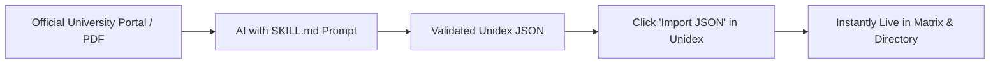

<div align="center">

# ⚡ UNIDEX

### Fast, Customizable College & Course Comparison Tracker

<p align="center">
  <b>Add any university, benchmark fees & specializations side-by-side, filter options, and export research notes to clean Markdown.</b>
</p>

[](LICENSE)
[](app.js)
[](#-quick-start)
[](#-architecture--privacy)
[](SKILL.md)

<br/>

[**🌐 Live Demo**](https://akshanr.github.io/Unidex/) · [**✨ Features**](#-key-features) · [**🤖 AI Extraction Skill**](#-the-ai-superpower-skillmd) · [**🚀 Quick Start**](#-quick-start) · [**📋 JSON Schema**](#-json-schema--extensibility)

<br/>

</div>

---

## 💡 Why Unidex?

Comparing postgraduate programs and universities is frustrating:
* Official university websites hide semester breakdowns, seat caps, and hidden caution deposits deep inside 50-page brochures.
* Course comparison aggregators are filled with sponsored ads and out-of-date fees.
* Manually copying tables into personal notes takes hours.

**Unidex solves this:** A blazing-fast, eye-friendly, local-first tracker that puts side-by-side fee matrices, specialization directories, and verified admission links on a single clean canvas.

> [!TIP]
> **Pre-loaded out of the box** with comprehensive 2026 data for **Christ University** (Delhi NCR & Online) and **Amity University** (Noida On-Campus & Online 8-Track Specializations).

---

## ✨ Key Features

| Feature | Description |
| :--- | :--- |
| **📊 Side-by-Side Comparison Matrix** | Benchmark multiple universities simultaneously across total tuition, per-semester cost, registration fees, eligibility, and delivery modes. |
| **🎓 Master Specializations Directory** | Dedicated index of specialized branches (Generative AI, Cyber Security, Data Science, Software Eng with HCLTech, FinTech with Paytm) with individual semester rates and verified portal links. |
| **🔍 Real-Time Filter & Sorter** | Instant search, university picker, delivery mode toggles (*On-Campus*, *Online*, *Specializations*), and fee sorting (Low &rarr; High / High &rarr; Low). |
| **🤖 AI Research Skill (`SKILL.md`)** | Don't write JSON manually. Hand the included AI prompt to ChatGPT, Claude, Gemini, or Antigravity to extract any college portal into Unidex format in 10 seconds. |
| **🌙 Warm Charcoal Eye-Friendly Theme** | Handcrafted dark and light modes with custom tokens, accessible contrast, and zero eye-straining blue light. |
| **📝 Markdown Notes Export** | Export your entire research workspace into a structured `.md` document ready for **Obsidian**, **Notion**, or GitHub notes. |
| **💾 100% Local-First & Private** | Zero accounts, zero tracking, zero external databases. All custom colleges and user edits persist locally in your browser's `localStorage`. |

---

## 🤖 The AI Superpower: `SKILL.md`

You can add **any university in the world** in under 30 seconds without manually typing a single semester fee table.



### 3-Step AI Workflow:

1. In Unidex, click **"Import JSON"** in the top navigation bar and hit **"📋 Copy AI Skill Prompt"** (or view [`SKILL.md`](SKILL.md)).
2. Paste the prompt to **ChatGPT, Claude, Gemini, or Antigravity** along with the target university name or course link:
   > *"Extract the 2026 MCA program details for Vellore Institute of Technology (VIT) using the Unidex schema."*
3. Paste the generated JSON into Unidex and click **"Import to Unidex"**. It immediately populates across all views and saves to your local storage!

<details>
<summary><b>🔍 View AI Skill Extraction Prompt Preview</b></summary>

```markdown
You are the Unidex College Research Assistant. Extract structured course and fee 
data from university portals or official admission notices into valid Unidex JSON.

Requirements:
1. Always break down fees per semester (Indian & International).
2. Note all one-time fees (registration, caution deposits, convocation charges).
3. Capture exact eligibility criteria (UG marks, 10+2 math mandate, entrance tests).
4. Extract all offered specializations with specific industry partners and direct links.
5. Return strictly valid JSON conforming to the Unidex schema.
```
*Full instructions and schema constraints are documented in [`SKILL.md`](SKILL.md).*
</details>

---

## 🖥️ Application Views

Unidex provides three specialized views tailored for different stages of college decision-making:

### 1. 🗂️ Notes View
Comprehensive college cards featuring tabbed navigation for each program:
* **Overview:** Campus location, accreditation, duration, delivery mode, and deadlines.
* **Fee Structure:** Interactive semester-by-semester breakdown with total estimated investment.
* **Eligibility & Selection:** Degree prerequisites, minimum aggregate percentages, and entrance tests.
* **Specializations:** Grid of available sub-disciplines with industry certifications.
* **Refund Policy:** Official UGC / university refund tiers and cutoff timelines.

### 2. 📊 Comparison Matrix
A compact, high-density matrix placing universities side-by-side. Compare total program fees, semester costs, eligibility thresholds, and admission links at a single glance.

### 3. 🎓 Master Specializations Directory
A unified index of specialized tracks across all universities:
* Real-time search across specialization names, industry partners, and universities.
* Partner badges (e.g., **Paytm**, **HCLTech**).
* Direct link to each specialization's dedicated curriculum page.

---

## 🚀 Quick Start

No build tools, package managers, or frameworks required.

### 1. Clone the repository
```bash
git clone https://github.com/AkshanR/Unidex.git
cd Unidex
```

### 2. Launch in your browser
Simply double-click `index.html` to open it in any browser, or run a lightweight local server:

```bash
# Using Python
python -m http.server 8000

# OR using Node.js
npx serve .
```
Visit `http://localhost:8000` in your browser.

---

## 🌐 Deploy Your Own Live Version (Free)

Host your personal copy of Unidex on **GitHub Pages** in under 60 seconds:

1. Fork or push this repository to your GitHub account.
2. Go to **Settings** &rarr; **Pages**.
3. Under **Build and deployment** &rarr; **Source**, choose **Deploy from a branch**.
4. Set branch to **`main`** and folder to **`/(root)`**, then click **Save**.
5. Your tracker will be live at `https://<your-username>.github.io/Unidex/` accessible from any smartphone, tablet, or PC!

---

## 📋 JSON Schema & Extensibility

Custom universities adhere to the clean, declarative Unidex JSON specification:

<details>
<summary><b>📄 Click to expand example JSON format</b></summary>

```json
{
  "id": "sample-university-mca",
  "university": "Example Institute of Technology",
  "program": "Master of Computer Applications (MCA)",
  "campus": "Bengaluru, Karnataka",
  "mode": "On-Campus",
  "duration": "2 Years (4 Semesters)",
  "deadline": "April 30, 2026",
  "fees": {
    "indian": {
      "semesters": [100000, 95000, 95000, 95000],
      "total": 385000,
      "registrationFee": 5000
    },
    "international": {
      "totalUSD": 5500
    }
  },
  "eligibility": {
    "degree": "BCA / B.Sc. / B.Com / B.A. with Mathematics at 10+2 or Degree level",
    "minMarks": "50% aggregate",
    "selectionProcess": "Merit-based + Personal Interview"
  },
  "specializations": [
    {
      "name": "Artificial Intelligence & Data Science",
      "mode": "On-Campus",
      "perSemFee": 110000,
      "partner": "Industry Partner",
      "url": "https://example.edu/mca/ai-ds"
    }
  ],
  "cancellationPolicy": "100% refund up to 15 days before formal orientation; sliding scale thereafter as per UGC norms.",
  "officialLink": "https://example.edu/mca"
}
```
</details>

---

## 🛠️ Technology Stack

Unidex is intentionally built with vanilla web technologies for zero maintenance overhead, maximum performance, and perpetual longevity:

* **Markup:** Semantic HTML5 with accessible ARIA landmarks.
* **Styling:** Modern Vanilla CSS using design tokens (CSS custom variables), fluid clamp typography, CSS Grid, and flexbox.
* **Logic:** Vanilla JavaScript (ES6+), local-first storage adapter, live search debouncing, and reactive DOM rendering.
* **Zero Dependencies:** No npm install, no bundlers, no external analytics, no bloatware.

---

## 🤝 Contributing

Contributions are warmly welcomed! If you would like to:
* Add pre-configured data for more universities or master's degrees (MBA, M.Tech, MS).
* Suggest UI/UX enhancements or comparison features.
* Improve the AI extraction prompt in [`SKILL.md`](SKILL.md).

Feel free to open an issue or submit a Pull Request.

```bash
# 1. Fork the repo
# 2. Create your feature branch
git checkout -b feat/add-new-university

# 3. Commit your changes
git commit -m "feat: add BITS Pilani MCA and M.Tech data"

# 4. Push to the branch and open a PR
git push origin feat/add-new-university
```

---

## 📄 License

Distributed under the **MIT License**. See [`LICENSE`](LICENSE) for full details.

<div align="center">
  <sub>Crafted with precision by <a href="https://github.com/AkshanR">AkshanR</a>. If you find Unidex useful, consider giving it a ⭐ on GitHub!</sub>
</div>
